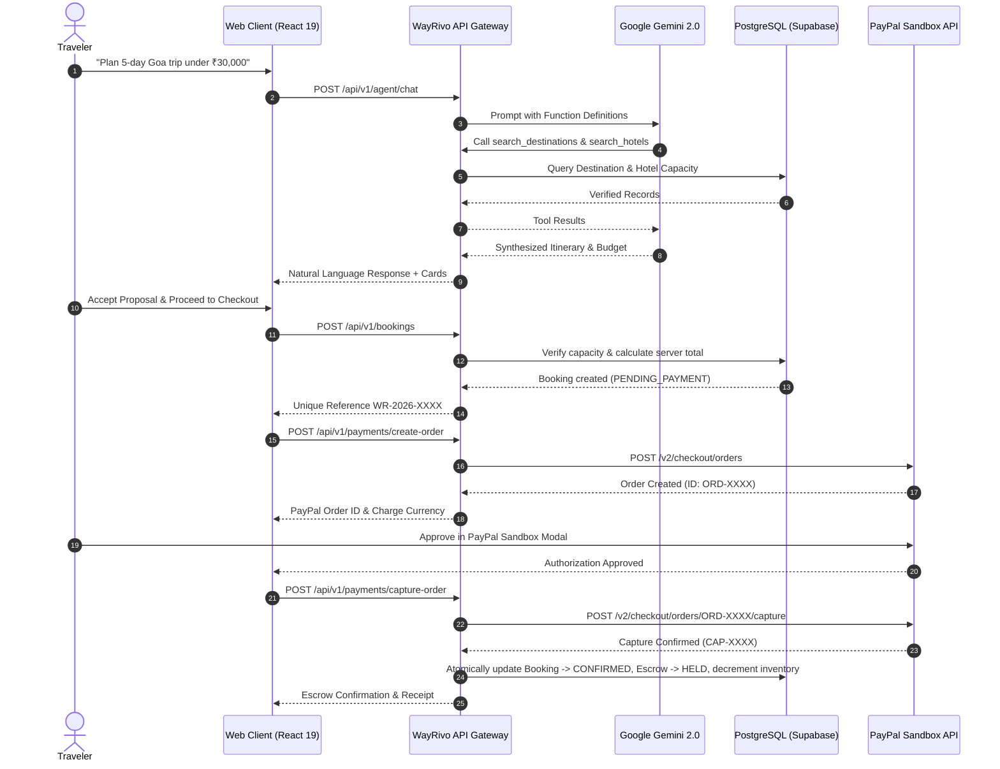

# WayRivo AI 2.0 — System Architecture & Design Specification
**Event**: PayPal AI Hackathon 2026  
**Version**: 2.0.0 (Production Ready)

---

## 1. Architectural Philosophy

WayRivo AI 2.0 is engineered as a multi-tier, autonomous travel commerce platform. It integrates conversational AI agents, dynamic budget optimization, real-time inventory management, and PayPal Developer Sandbox escrow smart checkout into a cohesive platform.

### Core Architecture Highlights
- **Decoupled Architecture**: High-performance React 19 SPA frontend powered by Vite, communicating with a stateless Node.js/Express TypeScript API gateway.
- **Single Source of Truth**: PostgreSQL database managed via Prisma ORM. Frontend prices and capacities are never trusted; all computations occur server-side.
- **Autonomous Tool Calling**: Google Gemini 2.0 Flash agent executes 10 authorized backend database tools with zero hallucinated pricing or inventory.
- **Escrow-Backed Commerce**: PayPal Orders API v2 integration with cryptographic webhook validation, idempotency guards, and administrator-controlled refund disbursement.

```
+-------------------------------------------------------------------------------+
|                           CLIENT TIER (React 19 + Vite)                       |
|   +-------------------+  +--------------------+  +------------------------+   |
|   | Cinematic Landing |  | AI Travel Agent UI |  | Interactive Itinerary  |   |
|   | & Dynamic Search  |  | (Gemini Streaming) |  | Dashboard & Budget Opt |   |
|   +-------------------+  +--------------------+  +------------------------+   |
|   +-------------------+  +--------------------+  +------------------------+   |
|   | User Dashboard    |  | Admin Command Panel|  | PayPal Smart Checkout  |   |
|   | (Trips & Escrow)  |  | (AG Grid + Charts) |  | & Printable Receipts   |   |
|   +-------------------+  +--------------------+  +------------------------+   |
+---------------------------------------+---------------------------------------+
                                        | HTTPS / REST / JSON
                                        v
+-------------------------------------------------------------------------------+
|                       BACKEND API GATEWAY (Node.js + Express)                 |
|   +-----------------------------------------------------------------------+   |
|   | Security & Middleware: Helmet, CORS, RateLimiter, CookieParser, Zod   |   |
|   +-----------------------------------------------------------------------+   |
|   +-------------------+  +--------------------+  +------------------------+   |
|   | Auth Controller   |  | Agent Controller   |  | Itinerary Controller   |   |
|   | (JWT + Cookies)   |  | (10 Tool Handlers) |  | (Budget Optimization)  |   |
|   +-------------------+  +--------------------+  +------------------------+   |
|   +-------------------+  +--------------------+  +------------------------+   |
|   | Booking Service   |  | PayPal Client SDK  |  | Admin & Telemetry      |   |
|   | (Capacity Guards) |  | (Orders v2/Escrow) |  | (AuditLog + Actions)   |   |
|   +-------------------+  +--------------------+  +------------------------+   |
+-------------------+-------------------+-------------------+-------------------+
                    |                   |                   |
                    v                   v                   v
+-----------------------+  +--------------------+  +----------------------------+
| Google Gemini 2.0 API |  | PostgreSQL Database|  | PayPal Developer Sandbox   |
| - gemini-2.0-flash    |  | (16 Prisma Models) |  | - Orders API v2            |
| - Function Calling    |  | - Supabase Pooler  |  | - Server-Side Captures     |
| - Context Memory      |  | - Database Indexes |  | - Cryptographic Webhooks   |
+-----------------------+  +--------------------+  +----------------------------+
```

---

## 2. Multi-Tier Component Breakdown

### A. Presentation Layer (Frontend)
- **Framework**: React 19.2 + TypeScript + Vite 8.2
- **Data Grids**: AG Grid Community (`ag-grid-react`, `ag-grid-community`) with customized dark quartz theme for administrative data management.
- **Data Visualizations**: Recharts (`AreaChart`, `BarChart`, `ResponsiveContainer`) for financial timelines, booking velocity, and AI telemetry.
- **Styling**: Tailwind CSS v4 with custom design tokens:
  - Midnight Navy: `#060A17`
  - Deep Blue: `#0B132B`
  - Electric Cyan: `#00F2FE`
  - Turquoise: `#4FACFE`
  - Champagne Gold: `#FAD961`
- **Routing & Guards**: React Router DOM v7 with role-based `ProtectedRoute` wrappers for `TRAVELER` and `ADMIN`.

### B. Business Logic & Integration Layer (Backend)
- **Runtime**: Node.js 24 + Express.js + TypeScript (`tsc` target ES2022)
- **Input Validation**: Zod runtime schema validation refined with capacity checks.
- **Authentication**: Bcrypt password hashing (10 rounds), JWT (`wayrivo_token`), secure HTTP-only cookies, and role-based access control.
- **Idempotency Architecture**: Custom `X-Idempotency-Key` tracking preventing double bookings and duplicate PayPal order captures.

### C. Autonomous AI Engine
- **Model**: Google Gemini 2.0 Flash (`gemini-2.0-flash`) via `@google/genai`
- **Tool Calling Orchestration**: 10 distinct tools interacting with database inventory:
  1. `search_destinations`
  2. `search_hotels`
  3. `search_activities`
  4. `search_packages`
  5. `get_hotel_details`
  6. `check_inventory_availability`
  7. `calculate_trip_budget`
  8. `generate_itinerary`
  9. `save_itinerary`
  10. `create_booking_proposal`
- **Audit Logging**: Every agent tool execution, latency (ms), input payload, and response status is recorded in the `AgentAction` table.

### D. Payment Gateway & Escrow Tier
- **Environment**: PayPal Developer Sandbox
- **APIs**:
  - `POST /v2/checkout/orders` (Order Initiation with dynamic currency conversion)
  - `POST /v2/checkout/orders/{id}/capture` (Server-to-Server Capture)
  - `POST /v2/payments/captures/{id}/refund` (Administrator-Controlled Refunds)
  - `POST /v1/notifications/verify-webhook-signature` (Cryptographic Webhook Validation)
- **Escrow State Machine**:
  `PENDING_PAYMENT` -> `CAPTURED` (Escrow `HELD`) -> `DISBURSED` or `REFUNDED`

---

## 3. End-to-End Sequence Diagram



