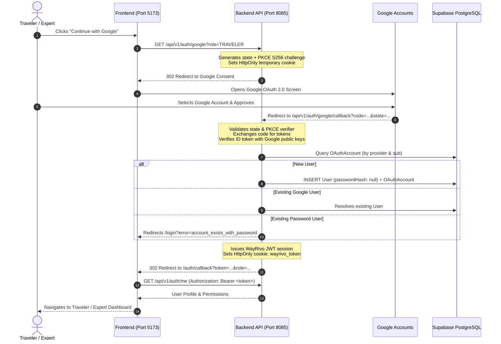

# Google OAuth 2.0 Setup & Integration Guide: WayRivo AI

This guide provides end-to-end instructions for creating and configuring Google OAuth 2.0 credentials in the **Google Cloud Console**, connecting them to **WayRivo AI**, and testing both local development and future production deployments (Vercel + Render).

---

## 1. Google Cloud Console Configuration

### Step 1: Open Google Cloud Console
1. Navigate to [Google Cloud Console](https://console.cloud.google.com/).
2. Sign in with your Google Developer or Google Workspace account.

### Step 2: Create or Select a Project
1. In the top navigation bar, click the project dropdown and click **New Project**.
2. **Project name**: `WayRivo AI` (or select an existing Google Cloud project).
3. Click **Create** and ensure the project is selected in the top bar.

### Step 3: Configure the OAuth Consent Screen
1. In the left navigation menu, open **APIs & Services** > **OAuth consent screen** (or **Google Auth Platform**).
2. **User Type**:
   - Choose **External** (allows any Google account to sign in).
   - Click **Create**.
3. **App information**:
   - **App name**: `WayRivo AI`
   - **User support email**: Select your email address.
   - **App logo** *(optional for local testing)*: Upload WayRivo AI brand mark.
4. **App domain**:
   - **Application home page**: `http://localhost:5173` *(Local)* or your Vercel URL *(Production)*.
   - **Privacy Policy link**: `http://localhost:5173/about` *(Local)*.
   - **Terms of Service link**: `http://localhost:5173/about` *(Local)*.
5. **Developer contact information**:
   - Enter your email address.
6. Click **Save and Continue**.

### Step 4: Configure OAuth Scopes
WayRivo AI follows the principle of least privilege and requires only 3 standard OpenID Connect scopes:
1. Click **Add or Remove Scopes**.
2. Select the following scopes:
   - `openid` (Associate your identity with WayRivo AI)
   - `.../auth/userinfo.email` (View your primary Google Account email address)
   - `.../auth/userinfo.profile` (View your personal info, including name and profile picture)
3. Click **Update** and then **Save and Continue**.

### Step 5: Configure Test Users (While in "Testing" Status)
While the OAuth consent screen status is **Testing**, only authorized test users can sign in:
1. Under **Test users**, click **Add Users**.
2. Enter the Gmail or Google Workspace addresses you plan to test with.
3. Click **Save and Continue**.
*(Note: When you are ready for public release, click **Publish App** on the OAuth consent screen dashboard to remove the 100-test-user restriction).*

---

## 2. Create OAuth 2.0 Client Credentials

1. In the left sidebar, navigate to **APIs & Services** > **Credentials**.
2. Click **+ Create Credentials** > **OAuth client ID**.
3. **Application type**: Select **Web application**.
4. **Name**: `WayRivo AI Web Client`.
5. **Authorized JavaScript origins**:
   - Add URI: `http://localhost:5173` *(Vite Frontend)*
   - Add URI: `http://localhost:8085` *(Express Backend)*
   - *(For production, add your Vercel frontend URL: `https://your-wayrivo-app.vercel.app`)*
6. **Authorized redirect URIs**:
   - Add exact URI: `http://localhost:8085/api/v1/auth/google/callback`
   - *(For production, add your Render backend URL: `https://your-wayrivo-backend.onrender.com/api/v1/auth/google/callback`)*
7. Click **Create**.
8. A modal appears displaying your:
   - **Client ID** (e.g., `1234567890-abcdefg.apps.googleusercontent.com`)
   - **Client Secret** (e.g., `GOCSPX-abc123xyz456`)

> [!CAUTION]
> **Never commit your `GOOGLE_CLIENT_SECRET` to GitHub or expose it in frontend code.** It must reside solely in the backend server environment.

---

## 3. Local Environment Configuration

Copy your credentials into `backend/.env`:

```env
# Google OAuth 2.0 Web Authentication
GOOGLE_CLIENT_ID=your-actual-client-id.apps.googleusercontent.com
GOOGLE_CLIENT_SECRET=your-actual-client-secret
GOOGLE_CALLBACK_URL=http://localhost:8085/api/v1/auth/google/callback
FRONTEND_URL=http://localhost:5173
BACKEND_URL=http://localhost:8085
```

Ensure `backend/.env.example` contains placeholders only:

```env
GOOGLE_CLIENT_ID="your-google-oauth-client-id.apps.googleusercontent.com"
GOOGLE_CLIENT_SECRET="your-google-oauth-client-secret"
GOOGLE_CALLBACK_URL="http://localhost:8085/api/v1/auth/google/callback"
FRONTEND_URL="http://localhost:5173"
BACKEND_URL="http://localhost:8085"
```

---

## 4. Architecture & Authentication Flow



---

## 5. Testing the Implementation Locally

### Startup Commands

Start both servers in separate terminals:

**Backend (Port 8085):**
```bash
cd backend
npm run dev
```

**Frontend (Port 5173):**
```bash
cd frontend
npm run dev
```

---

### Verification Test Cases

| Scenario | Steps | Expected Result |
| :--- | :--- | :--- |
| **1. New Google Registration** | Open `http://localhost:5173/register`, click **Continue with Google**, choose an authorized account. | User created in Supabase with `role: TRAVELER`, `isEmailVerified: true`, `passwordHash: null`, `OAuthAccount` row added with Google `sub`. Redirects to `/traveler/dashboard`. |
| **2. Existing Google Login** | Log out, open `http://localhost:5173/login`, click **Continue with Google**, choose the same account. | Logs in instantly. No duplicate user created. Total user count remains unchanged. |
| **3. Existing Password User Protection** | Create user with email `alice@example.com` and password. Attempt to sign in with a Google account using `alice@example.com`. | Silent merge is blocked. Redirects to `/login?error=account_exists_with_password` with email autofilled and notice to use password. |
| **4. Google Cancellation** | Click **Continue with Google**, then click **Cancel** on Google consent. | Redirects safely to `/login?error=google_cancelled` with polite banner: "Google authentication was cancelled." |
| **5. CSRF State Tampering** | Forge or alter the `state` query parameter. | Callback rejects with `400 Bad Request` ("Invalid OAuth state. Potential CSRF attack detected"). |
| **6. Protected Session Access** | Access `/traveler/dashboard` with Google session. Refresh page. | Session persists via JWT and HTTP-only cookie. User profile loads seamlessly. |

---

## 6. Automated Test Suite

Run the automated test suite covering PKCE, state HMAC validation, scenario resolution, unique constraints, and cascade deletion:

```bash
cd backend
npx tsx test-google-oauth.ts
```

Output:
```
======================================================================
🌐 WayRivo AI 2.0: Google OAuth 2.0 Complete Verification Test Suite
Backend Target: http://localhost:8085/api/v1
======================================================================

✅ PASS: GET /auth/google generates S256 PKCE challenge, state, and Google OAuth URL
✅ PASS: GET /auth/google sets secure HTTP-only temporary state cookie
✅ PASS: Callback rejects missing state or code with safe error redirect
✅ PASS: Callback handles Google consent cancellation (access_denied) safely
✅ PASS: State validation rejects CSRF mismatch and tampered signatures
✅ PASS: Scenario A: Creates new User and OAuthAccount mapping with verified Google sub
✅ PASS: Scenario B: Authenticates existing Google user and avoids duplicate accounts
✅ PASS: Scenario C: Rejects silent account linking when password exists, allows explicit linking
✅ PASS: JWT issued to Google user accesses protected /auth/me profile route
✅ PASS: OAuthAccount unique constraint prevents duplicate providerAccountId
✅ PASS: Foreign key cascade deletes OAuthAccount when User is deleted

======================================================================
🎉 TEST SUMMARY: 11 Passed, 0 Failed
======================================================================
```

---

## 7. Future Production Deployment (Vercel + Render)

When deploying to production, follow these steps without modifying code:

### 1. Update Google Cloud Console Credentials
Add your production URLs to the OAuth Client ID:
- **Authorized JavaScript origins**:
  - `https://your-project.vercel.app`
  - `https://your-backend.onrender.com`
- **Authorized redirect URIs**:
  - `https://your-backend.onrender.com/api/v1/auth/google/callback`

### 2. Set Render Backend Environment Variables
In the Render.com dashboard for your backend Web Service, set:
```env
GOOGLE_CLIENT_ID=your-actual-client-id.apps.googleusercontent.com
GOOGLE_CLIENT_SECRET=your-actual-client-secret
GOOGLE_CALLBACK_URL=https://your-backend.onrender.com/api/v1/auth/google/callback
FRONTEND_URL=https://your-project.vercel.app
BACKEND_URL=https://your-backend.onrender.com
CORS_ORIGIN=https://your-project.vercel.app
```

### 3. Set Vercel Frontend Environment Variables
In the Vercel dashboard for your frontend project, set:
```env
VITE_API_BASE_URL=https://your-backend.onrender.com/api
```

