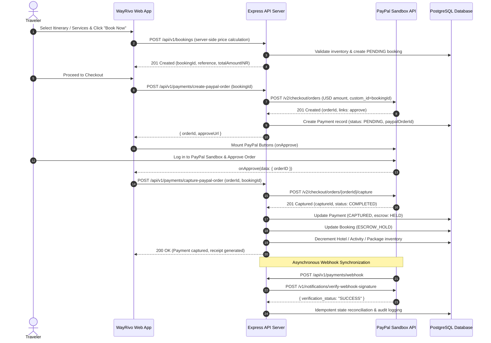

# WayRivo AI 2.0 — PayPal Commerce Integration Guide

## 1. Overview & Architecture

WayRivo AI 2.0 integrates with **PayPal Developer Sandbox (v2 Orders & Payments REST API)** to provide secure, end-to-end travel booking checkout, currency conversion, escrow payment holds, automated webhook synchronization, and administrative refund management.



---

## 2. PayPal Sandbox Configuration

### Environment Variables
Configure the backend with PayPal Developer credentials in `backend/.env`:

```env
# PayPal API Credentials
PAYPAL_CLIENT_ID=your_sandbox_client_id_here
PAYPAL_CLIENT_SECRET=your_sandbox_client_secret_here
PAYPAL_MODE=sandbox
PAYPAL_API_BASE=https://api-m.sandbox.paypal.com
PAYPAL_WEBHOOK_ID=your_sandbox_webhook_id_here
```

### Sandbox Accounts
1. **Business Account** (`facilitator`):
   - Receives customer payments.
   - Manages escrow reserves and webhook web endpoints.
2. **Personal Account** (`buyer`):
   - Simulates traveler transactions during integration tests.
   - Initialized with sandbox credit/checking balance.

---

## 3. Server-Side Price Calculation & Currency Conversion

### Deterministic Price Engine
To eliminate client-side price tampering, all prices are calculated server-side from PostgreSQL records:
1. When `POST /api/v1/bookings` is invoked, any client-submitted `unitPrice` or `totalAmount` is discarded.
2. The server queries `hotels`, `activities`, and `travel_packages` for current base rates.
3. Total INR is calculated with exact tax rate logic:
   $$\text{Subtotal} = \sum (\text{item.unitPrice} \times \text{item.quantity})$$
   $$\text{Tax (18\% GST)} = \text{Subtotal} \times 0.18$$
   $$\text{Total INR} = \text{Subtotal} + \text{Tax}$$

### Currency Conversion (INR $\to$ USD)
PayPal Orders in Sandbox are billed in USD. The backend dynamically converts INR to USD using a configurable exchange rate (`EXCHANGE_RATE_INR_USD` default: `0.012`):
$$\text{Amount USD} = \text{round}(\text{Total INR} \times 0.012, 2)$$
- Rounded to 2 decimal places.
- Validated to prevent zero-amount transactions.

---

## 4. End-to-End API Integration

### 4.1 Create PayPal Order
- **Endpoint**: `POST /api/v1/payments/create-paypal-order`
- **Headers**: `Authorization: Bearer <jwt_token>`
- **Request Body**:
```json
{
  "bookingId": "cm3a4b5c6d7e8f9g0h1i2j3k"
}
```
- **Backend Flow**:
  1. Validates that booking exists and belongs to the authenticated user.
  2. Ensures booking is in `PENDING` status.
  3. Obtains OAuth2 Access Token from PayPal (`POST /v1/oauth2/token` with HTTP Basic Auth).
  4. Calls PayPal `POST /v2/checkout/orders` with payload:
```json
{
  "intent": "CAPTURE",
  "purchase_units": [
    {
      "reference_id": "booking_cm3a4b5c6d7e8f9g0h1i2j3k",
      "custom_id": "cm3a4b5c6d7e8f9g0h1i2j3k",
      "description": "WayRivo Travel Booking #BK-948201",
      "amount": {
        "currency_code": "USD",
        "value": "298.50",
        "breakdown": {
          "item_total": { "currency_code": "USD", "value": "298.50" }
        }
      }
    }
  ],
  "application_context": {
    "brand_name": "WayRivo AI",
    "landing_page": "NO_PREFERENCE",
    "user_action": "PAY_NOW",
    "return_url": "http://localhost:5173/booking/success",
    "cancel_url": "http://localhost:5173/booking/cancel"
  }
}
```
  5. Stores payment record with `paypalOrderId` and status `PENDING`.
  6. Returns PayPal order details and approval links to frontend.

---

### 4.2 Capture PayPal Order
- **Endpoint**: `POST /api/v1/payments/capture-paypal-order`
- **Request Body**:
```json
{
  "orderId": "7XY12345678901234",
  "bookingId": "cm3a4b5c6d7e8f9g0h1i2j3k"
}
```
- **Backend Flow**:
  1. Checks for idempotent double capture: If payment is already `CAPTURED`, returns existing transaction details.
  2. Acquires fresh PayPal OAuth token.
  3. Calls PayPal `POST /v2/checkout/orders/{orderId}/capture`.
  4. Parses capture response: extracts `captureId`, `payer`, `seller_receivable_breakdown`.
  5. Updates database:
     - Payment status: `CAPTURED`
     - Capture ID: Stored in DB
     - Escrow status: `HELD`
     - Booking status: `ESCROW_HOLD`
  6. Decrements room/activity/package capacity to guarantee reservations.
  7. Returns payment confirmation and receipt metadata.

---

### 4.3 Webhook Handling & Signature Verification
- **Endpoint**: `POST /api/v1/payments/webhook`
- **Headers Verified**:
  - `PAYPAL-AUTH-ALGO`
  - `PAYPAL-CERT-URL`
  - `PAYPAL-TRANSMISSION-ID`
  - `PAYPAL-TRANSMISSION-SIG`
  - `PAYPAL-TRANSMISSION-TIME`
- **Verification Routine**:
  1. Backend receives webhook payload.
  2. Constructs verification request to PayPal:
```json
POST https://api-m.sandbox.paypal.com/v1/notifications/verify-webhook-signature
{
  "auth_algo": "SHA256withRSA",
  "cert_url": "https://api.sandbox.paypal.com/v1/notifications/certs/CERT-...",
  "transmission_id": "...",
  "transmission_sig": "...",
  "transmission_time": "...",
  "webhook_id": "WH-908123456789",
  "webhook_event": { ... }
}
```
  3. If `verification_status !== "SUCCESS"`, the webhook is rejected with `400 Bad Request` or `401 Unauthorized`.
  4. Handles event types:
     - `PAYMENT.CAPTURE.COMPLETED`: Marks payment `CAPTURED`, confirms booking.
     - `PAYMENT.CAPTURE.DENIED`: Marks payment `FAILED`, cancels booking, restores inventory.
     - `PAYMENT.CAPTURE.REFUNDED`: Marks payment `REFUNDED`, updates booking to `CANCELLED`.

---

## 5. Travel Escrow Mechanism

WayRivo AI protects both travelers and travel vendors using a built-in **Escrow Hold & Release System**:

```
[Payment Captured] 
       │
       ▼
 [Escrow Status: HELD]  <── Funds safely held in platform escrow
       │
       ├─────────────────────────────────┐
       ▼                                 ▼
[Tour / Trip Completed]        [Trip Cancelled within Policy]
       │                                 │
       ▼                                 ▼
 [Admin / System Release]       [Admin / Auto Refund]
       │                                 │
       ▼                                 ▼
 [Escrow Status: RELEASED]      [Escrow Status: REFUNDED]
 (Payout to Vendor)             (Refunded to Traveler via PayPal)
```

1. **Escrow Hold (`HELD`)**: On capture, funds are locked in escrow. Booking is tagged `ESCROW_HOLD`.
2. **Escrow Release (`RELEASED`)**:
   - Endpoint: `POST /api/v1/admin/bookings/:id/release-escrow`
   - Role required: `ADMIN`
   - Verifies trip completion date.
   - Marks booking `COMPLETED` and escrow status `RELEASED`.
3. **Escrow Refund (`REFUNDED`)**:
   - Initiated via `POST /api/v1/admin/refunds/process`.
   - Executes PayPal refund API.

---

## 6. Refunds & Cancellation Workflow

### Administrative Refund API
- **Endpoint**: `POST /api/v1/admin/refunds/process`
- **Access**: Strictly restricted to `ADMIN` role (`authenticateToken` + `requireAdmin`).
- **Request Body**:
```json
{
  "bookingId": "cm3a4b5c6d7e8f9g0h1i2j3k",
  "amount": 298.50,
  "reason": "Traveler requested cancellation within 48-hour free window"
}
```
- **PayPal Refund Call**:
```http
POST https://api-m.sandbox.paypal.com/v2/payments/captures/{captureId}/refund
Authorization: Bearer <access_token>
Content-Type: application/json

{
  "amount": {
    "value": "298.50",
    "currency_code": "USD"
  },
  "note_to_payer": "Full refund processed by WayRivo AI"
}
```
- **Post-Refund Updates**:
  1. Database Payment record set to `REFUNDED` with `refundId`.
  2. Booking status updated to `CANCELLED`.
  3. Reserved hotel rooms and activity spots are automatically returned to inventory.

---

## 7. Security & Failure Recovery

| Risk | Mitigation Mechanism |
|---|---|
| **Price Tampering** | Complete server-side price computation querying database tables; client values ignored. |
| **Double Capture** | Idempotency guard on `capture-paypal-order`; rejects already-captured payments. |
| **Spoofed Webhooks** | Full cryptographic signature verification against PayPal cert URLs. |
| **Network Failure during Capture** | Transactional database rollbacks (`prisma.$transaction`) guarantee consistency. |
| **Inventory Overselling** | Pre-order room/seat locks and atomic inventory decrements. |
| **Unauthorized Refunds** | Role-Based Access Control (`requireAdmin`) and audit logging on all refund actions. |
